<div align="center">

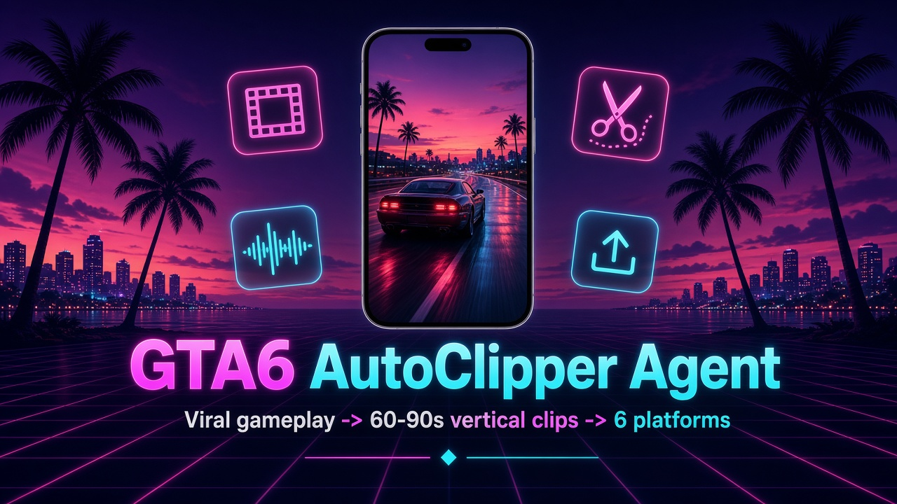

# GTA6 AutoClipper Agent

**GTA 6 full video automation for Grok Bot / Claude agents.**
Finds viral gameplay, cuts 60-90 s full-view vertical clips, writes per-platform SEO, and posts to YouTube, Instagram, Facebook and TikTok after your "yes".

<p>


</p>
<p>


</p>

<a href="#-one-command-install">Install</a> · <a href="#-demo">Demo</a> · <a href="#-full-view-layout">Layout</a> · <a href="#-pipeline">Pipeline</a> · <a href="#-grok-bot-template">Grok template</a> · <a href="#-live-results-2026-11-20">Live results</a> · <a href="LINKS.md">Full links</a>

</div>

---

## Table of contents
1. [What it does](#-what-it-does)
2. [Demo](#-demo)
3. [Full-view layout](#-full-view-layout)
4. [Pipeline](#-pipeline)
5. [Toolchain](#-toolchain)
6. [Skills](#-skills)
7. [Connectors](#-connectors)
8. [One-command install](#-one-command-install)
9. [Manual setup, step by step](#-manual-setup-step-by-step)
10. [Usage examples](#-usage-examples)
11. [Grok Bot template](#-grok-bot-template)
12. [Live results (2026-11-20)](#-live-results-2026-11-20)
13. [Repo layout](#-repo-layout)
14. [Security](#-security)
15. [Credits](#-credits)
16. [License](#-license)
17. [Author](#-author)

---

## 🎯 What it does

| Step | What happens | Tools |
|---|---|---|
| 1. **Trend radar** | Ranks the last 24 h of GTA 6 videos by views/hour, finds who is live, finds paid clipping campaigns | gtavi `trends.py` / `streams.py`, YouTube Data API, TubeAlfred, vidIQ, trendspy, Firecrawl |
| 2. **Best moment** | Scores moments by loudness spikes, hype words, action, "most replayed" and chat spikes. Keeps only the **single best viral gameplay moment** | gtavi `moments.py`, faster-whisper, PySceneDetect |
| 3. **Cut** | 60-90 s, **full 16:9 gameplay centered over a blurred background**, hook on top, word captions on the bottom, -14 LUFS | ffmpeg, `scripts/blur_layout.sh`, gtavi `cut.py --layout blur`, auto-editor |
| 4. **QA** | Resolution, fps, audio, duration 60-90 s, banned words, campaign rules | gtavi `check.py`, `gtavi-rule-check` |
| 5. **SEO pack** | Per-platform title, description, hashtags, category and a **top-50 keyword block**; 28 YouTube tags | vidIQ, trendspy, youtube-seo, hashtag-strategy, social-seo, sms-hook-writer |
| 6. **Approval** | Owner previews the clip and says **yes** for that clip. No yes, no post. | Zernio `validate_post` + `show_post_preview` |
| 7. **Post x6** | YouTube, Instagram, Facebook x2, TikTok via Zernio; second YouTube via Postpone | Zernio, Postpone |
| 8. **Learn** | 24-72 h numbers feed the next pick | `gtavi-learning-loop` |

It runs as a **crew**: the clipper bot (lead), a **Scout** (trends, scores, SEO) and an **Editor** (cut, QA), coordinated in one group chat, plus a daily 09:00 routine.

---

## 🎬 Demo

<table>
<tr>
<td align="center" width="50%">
<b>Full-view layout (the default now)</b><br>
<a href="assets/demo-full-view-layout.mp4">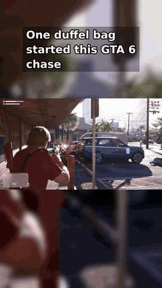</a><br>
<sub><a href="assets/demo-full-view-layout.mp4">▶ 18 s MP4 preview</a> · rendered with <code>scripts/blur_layout.sh</code></sub>
</td>
<td align="center" width="50%">
<b>Live clip, posted 2026-11-20</b><br>
<a href="https://www.youtube.com/watch?v=KKRncjPhboY">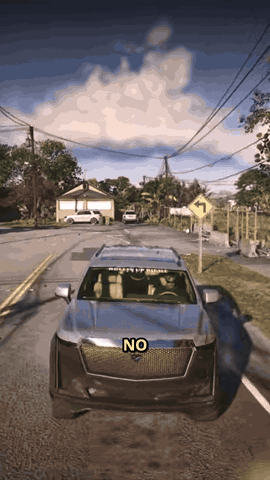</a><br>
<sub><a href="assets/demo-live-clip-preview.mp4">▶ 18 s MP4 preview</a> · <a href="https://www.youtube.com/watch?v=KKRncjPhboY">watch on YouTube</a></sub>
</td>
</tr>
</table>

<p align="center">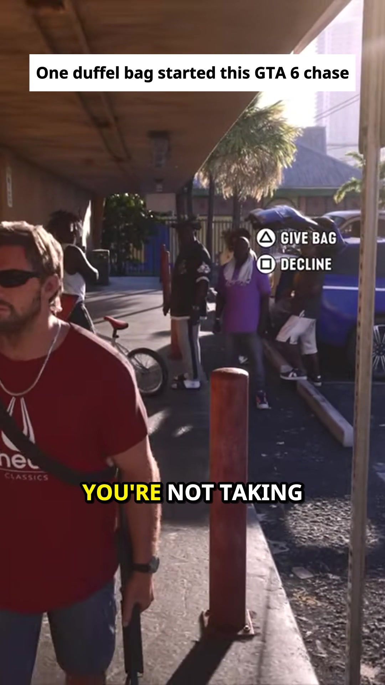 &nbsp; 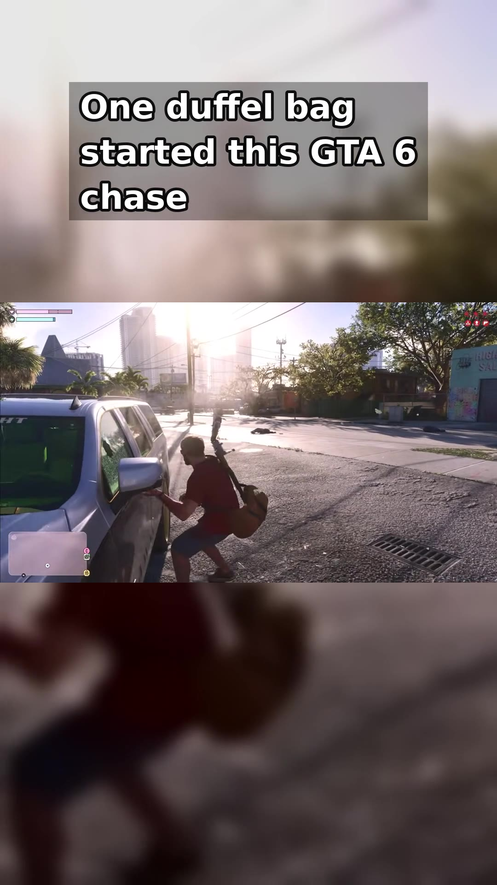 &nbsp; 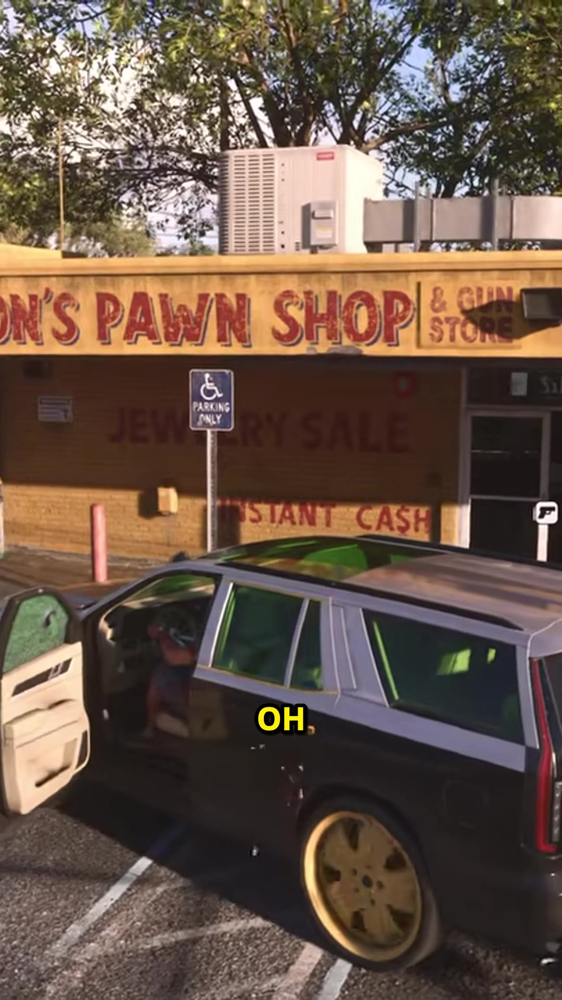</p>

<sub>Gameplay: <a href="https://www.youtube.com/watch?v=2EaoIgWAW5g">LuxeDude, "10 HOURS of GTA 6 Free Roam Gameplay! (No Spoilers)"</a>, credited in every post. Full example job in <a href="examples/">examples/</a>.</sub>

---

## 🖼 Full-view layout

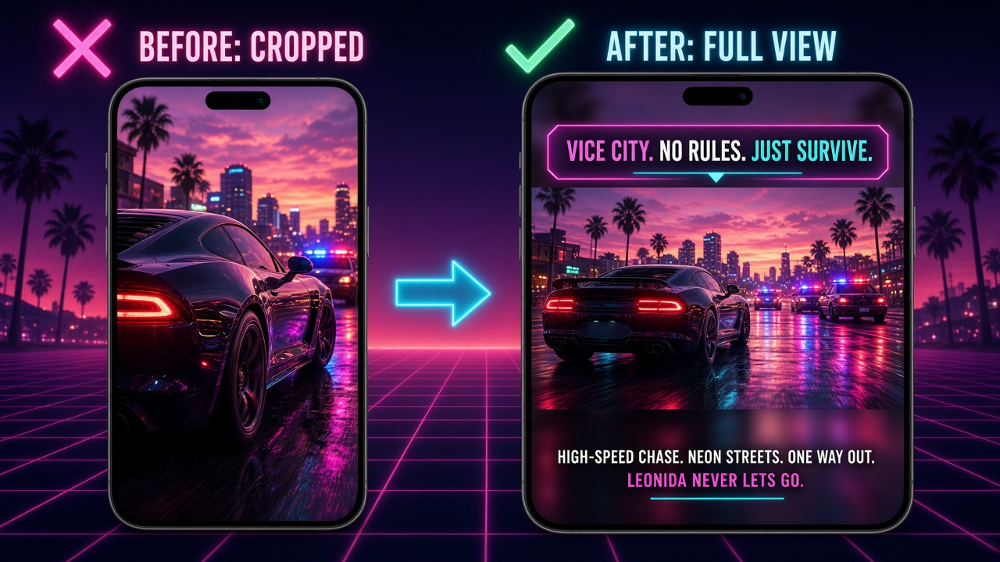

**Never crop the gameplay.** The whole 16:9 frame sits in the middle of the 1080x1920 canvas; a blurred, darkened copy of the same video fills the rest. The hook goes in the top band, captions in the bottom band. Reference style: [youtube.com/shorts/BUwxAT5xoLc](https://youtube.com/shorts/BUwxAT5xoLc).

```bash
[0:v]split=2[bg][fg];
[bg]scale=1080:1920:force_original_aspect_ratio=increase,crop=1080:1920,boxblur=20:2,eq=brightness=-0.08[bgb];
[fg]scale=1080:-2[fgs];
[bgb][fgs]overlay=(W-w)/2:(H-h)/2
```

```bash
scripts/blur_layout.sh source.mp4 out/clip.mp4 7.75 89.5 "One duffel bag started this GTA 6 chase" out/clip.srt
```

Details, band positions and knobs: [docs/LAYOUT.md](docs/LAYOUT.md).

---

## 🔁 Pipeline

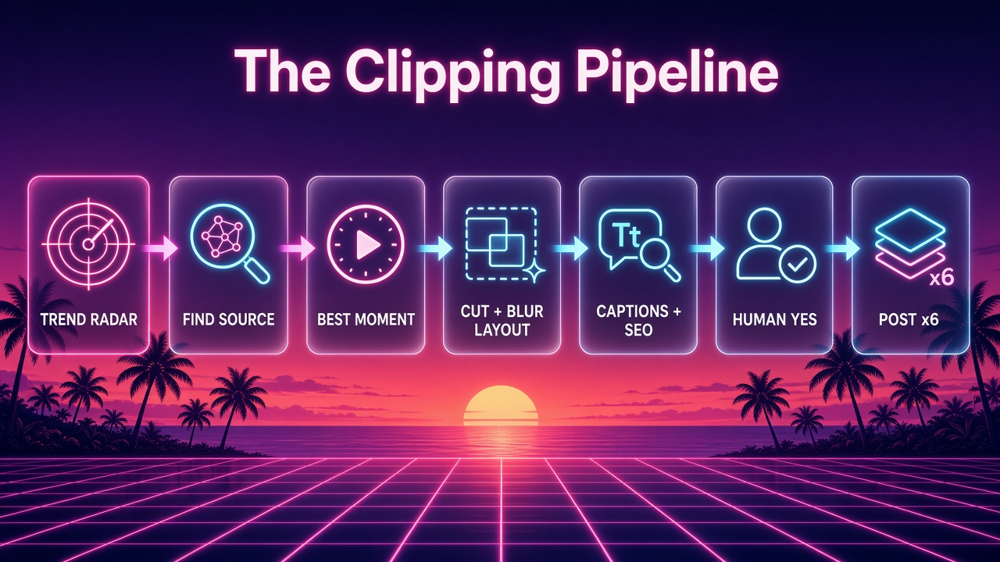

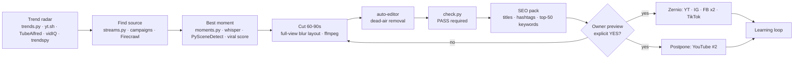

Full architecture (components, per-job checklist, fallbacks, known blockers): [docs/ARCHITECTURE.md](docs/ARCHITECTURE.md).

---

## 🧰 Toolchain

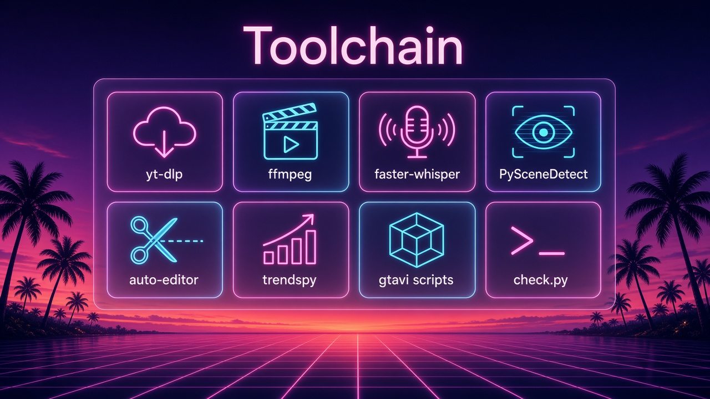

| Tool | Role | Author |
|---|---|---|
| [gtavi-claudecode](https://github.com/Bodila51/gtavi-claudecode) | Base desk: trends, streams, campaigns, moments, cut, `check.py` (bundled in `vendor/`, patched to 60-90 s) | [@Bodila51](https://github.com/Bodila51) |
| [yt-dlp](https://github.com/yt-dlp/yt-dlp) | Section downloads (`--download-sections`) | [@yt-dlp](https://github.com/yt-dlp) |
| [FFmpeg](https://ffmpeg.org) | Blur layout, burn-in captions, loudnorm -14 LUFS | [@FFmpeg](https://github.com/FFmpeg) |
| [faster-whisper](https://github.com/SYSTRAN/faster-whisper) | Word-level captions (small model) | [@SYSTRAN](https://github.com/SYSTRAN) |
| [PySceneDetect](https://github.com/Breakthrough/PySceneDetect) | Cut on shot changes | [@Breakthrough](https://github.com/Breakthrough) |
| [auto-editor](https://github.com/WyattBlue/auto-editor) | Remove dead air on every edit | [@WyattBlue](https://github.com/WyattBlue) |
| [trendspy](https://github.com/sdil87/trendspy) | Google Trends keywords | [@sdil87](https://github.com/sdil87) |
| [bgutil-ytdlp-pot-provider](https://github.com/Brainicism/bgutil-ytdlp-pot-provider) | Optional PO-token plugin for yt-dlp | [@Brainicism](https://github.com/Brainicism) |

---

## 🧠 Skills

37 agent skills in [`skills/`](skills/) (works with Grok Bot, Claude Code, Cursor, Codex):

- **Master:** `gta6-clipper-master-guide` (load before every job), `gta6-clipper-getting-started`
- **GTA 6 desk (16):** `gtavi-setup` · `gtavi-playbook` · `gtavi-trend-radar` · `gtavi-stream-finder` · `gtavi-campaign-finder` · `gtavi-moment-finder` · `gtavi-clip-cutter` · `gtavi-hook-writer` · `gtavi-live-mode` · `gtavi-twitch-reaction` · `gtavi-multilang` · `gtavi-rule-check` · `gtavi-learning-loop` · `gtavi-questions-to-posts` · `gtavi-secrets-map` · `gtavi-cheat-codes`
- **Editing (5):** `auto-editor` · `auto-editor-effects` · `auto-editor-export` · `auto-editor-transcribe` · `auto-editor-transitions`
- **SEO (2):** `youtube-seo` · `seo-title-optimization`
- **Social growth (8):** `hashtag-strategy` · `social-seo` · `sms-hook-writer` · `captions-and-clipping` · `platform-specs-and-validation` · `instagram-seo` · `tiktok-growth` · `youtube-shorts`
- **Research (4):** `sc-comment-mining` · `sc-outlier-post-finder` · `sc-transcript-intelligence` · `sc-trend-discovery`

Authors per group: [skills/README.md](skills/README.md).

---

## 🔌 Connectors

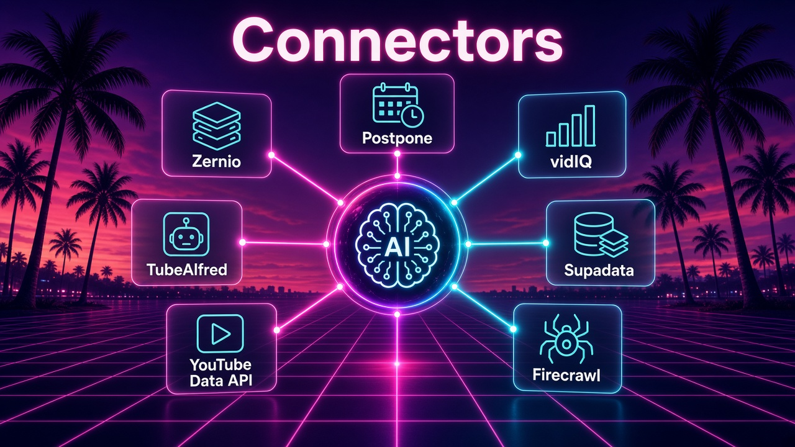

| Connector | Used for | How |
|---|---|---|
| [Zernio](https://zernio.com) | Validate, preview, publish: YouTube, Instagram, Facebook x2, TikTok | MCP connector in your agent |
| [Postpone](https://www.postpone.app) | Schedule the second YouTube channel (no publish-now: earliest slot) | [`scripts/helpers/postpone.sh`](scripts/helpers/postpone.sh) + `POSTPONE_API_KEY` |
| [vidIQ](https://vidiq.com) | Keyword research, competition, trending (uses credits) | MCP `https://mcp.vidiq.com/mcp` |
| [TubeAlfred](https://tubealfred.com) | YouTube search + transcripts (first choice for transcripts) | MCP connector |
| [Supadata](https://supadata.ai) | Transcript / metadata fallback, non-YouTube sources | [`scripts/helpers/supadata.sh`](scripts/helpers/supadata.sh) + `SUPADATA_API_KEY` |
| [YouTube Data API v3](https://developers.google.com/youtube/v3) | Official stats, search, live (10k units/day) | [`scripts/helpers/yt.sh`](scripts/helpers/yt.sh) + `YOUTUBE_API_KEY` |
| [Firecrawl](https://www.firecrawl.dev) | Campaign pages, news, web search | MCP / `FIRECRAWL_API_KEY` |

> ⚠️ Zernio and Postpone can't set YouTube **Tags**, **Category = Gaming** or made-for-kids. Set those in YouTube Studio after posting (the 28 tags are in the publish pack).

---

## ⚡ One-command install

```bash
curl -fsSL https://raw.githubusercontent.com/Maliot100X/GTA6-AutoClipper-Agent/main/install.sh | bash
```

Installs ffmpeg, a Python venv with yt-dlp, faster-whisper, PySceneDetect and trendspy, the official auto-editor binary, the bundled gtavi scripts, copies all 37 skills to `~/.claude/skills` (never overwrites), and creates `.env` from `.env.example`.

| Option | Effect |
|---|---|
| `DRY_RUN=1` | Print every step, change nothing |
| `INSTALL_DIR=~/clipper` | Install somewhere else (default `~/GTA6-AutoClipper-Agent`) |
| `SKILLS_DIR=~/.cursor/skills` | Copy skills elsewhere |
| `SKIP_SYSTEM=1` | Skip apt/brew/dnf |
| `WITH_POT=1` | Add the yt-dlp PO-token plugin |
| `WHISPER_PREFETCH=1` | Pre-download the Whisper small model |

```bash
curl -fsSL https://raw.githubusercontent.com/Maliot100X/GTA6-AutoClipper-Agent/main/install.sh | DRY_RUN=1 bash
```

---

## 🛠 Manual setup, step by step

```bash
# 1. system tools
sudo apt-get install -y ffmpeg git curl python3 python3-venv     # macOS: brew install ffmpeg git python
# 2. repo
git clone https://github.com/Maliot100X/GTA6-AutoClipper-Agent.git && cd GTA6-AutoClipper-Agent
# 3. python tools
python3 -m venv .venv && .venv/bin/pip install -r requirements.txt
# 4. auto-editor (pick your platform asset from the releases page)
mkdir -p bin && curl -fsSL -o bin/auto-editor https://github.com/WyattBlue/auto-editor/releases/download/31.9.0/auto-editor-linux-x86_64 && chmod +x bin/auto-editor
# 5. skills for your agent
cp -rn skills/* ~/.claude/skills/
# 6. keys (env only, never in code)
cp .env.example .env && chmod 600 .env && nano .env
# 7. load env for this shell
source .venv/bin/activate && set -a && . ./.env && set +a && export PATH="$PWD/bin:$PATH"
# 8. smoke test
scripts/gtavi.sh check --help && auto-editor --version && scenedetect version
```

Then connect Zernio, vidIQ, TubeAlfred and Firecrawl in your agent (Grok Bot: Connectors; Claude: MCP servers). More: [docs/QUICKSTART.md](docs/QUICKSTART.md).

---

## 🚀 Usage examples

```bash
# Trend radar: last 24 h of GTA 6 videos ranked by views/hour
scripts/gtavi.sh trends --hours 24 --limit 20
scripts/helpers/yt.sh search "GTA 6 gameplay" 1 viewCount | jq '.items[].snippet.title'
scripts/gtavi.sh streams --limit 10                              # who is live now

# Moment finder: best 60-90 s moments in a VOD
scripts/gtavi.sh moments "https://www.youtube.com/watch?v=2EaoIgWAW5g" --top 5 --min 60 --max 90

# Cut with the full-view blur layout
scripts/gtavi.sh cut jobs/<id> --pick 1 --layout blur --hook "One duffel bag started this GTA 6 chase"
# ...or straight from any 16:9 file
scripts/blur_layout.sh raw/source.mp4 out/clip.mp4 7.75 89.5 "One duffel bag started this GTA 6 chase"

# Remove dead air, then QA (must PASS 60-90 s, 1080x1920, 30 fps, audio)
auto-editor out/clip.mp4 --margin 0.3s -o out/clip_tight.mp4
scripts/gtavi.sh check out/clip_tight.mp4 --caption "$(cat out/caption.txt)"

# Transcripts: TubeAlfred (agent) -> Supadata -> Whisper
scripts/helpers/supadata.sh transcript "https://www.youtube.com/watch?v=2EaoIgWAW5g"

# Postpone: list tools / accounts (posting only after an explicit yes)
scripts/helpers/postpone.sh tools
scripts/helpers/postpone.sh call postpone_list_social_accounts '{}'
```

Agent prompt:

> Load the `gta6-clipper-master-guide` skill. Run one clip job: trend scan, pick the single best viral gameplay moment, cut it 60-90 s in the full-view blur layout, run auto-editor and check.py, write the publish pack for all my accounts, show me the preview and wait for my yes.

Example outputs: [examples/clip-2026-11-20](examples/clip-2026-11-20) · pack format: [docs/PUBLISHING.md](docs/PUBLISHING.md) · approval flow: [docs/POSTING_WORKFLOW.md](docs/POSTING_WORKFLOW.md).

---

## 🤖 Grok Bot template

Import the whole bot (skills, memories, daily routine, connectors) in one click:

| Where | Link |
|---|---|
| **x.ai template** | **https://x.ai/bot/HxIcmO9dnz8X_puS1ssan** |
| **Grok Bot Directory** | **https://grok-bot.directory/bots/gta-6-automated-clipper** |

The imported bot starts with a setup chat: it asks for your accounts, installs this toolchain on its own computer and offers to create its **Scout** and **Editor** helpers. Crew roles and routine: [docs/GROK_TEMPLATE.md](docs/GROK_TEMPLATE.md).

---

## 📈 Live results (2026-11-20)

### Set 1: "GTA 6 chase started over one duffel bag" (this bot, posted once on each of 6 accounts)

| Platform | Account | Post |
|---|---|---|
| YouTube Shorts | rakazaiterminal | https://www.youtube.com/watch?v=KKRncjPhboY |
| Instagram Reels | animelabhub | https://www.instagram.com/reel/Df8j9vflM9C/ |
| Facebook Reels | Animelabhub | https://www.facebook.com/reel/1741779567511077/ |
| Facebook Reels | AHDomo | https://www.facebook.com/reel/1409949517876496/ |
| TikTok | demonslayerdoses | https://www.tiktok.com/@demonslayerdoses/video/7710071830110915872 |
| YouTube Shorts (via Postpone) | @hashiraauraedits | https://www.youtube.com/shorts/Oec_m2GoNUI |

Each post has its own caption, the creator credit, hashtags and the top-50 keyword block. YouTube tags and the Gaming category have to be set by hand in YouTube Studio (the connectors cannot set them).

### Set 2 (CLAWCADE's other bot)

| Platform | Account | Post |
|---|---|---|
| YouTube Shorts | — | https://www.youtube.com/watch?v=BUwxAT5xoLc |
| Instagram Reels | — | https://www.instagram.com/reel/Df8fCVQDr7_/ |
| Facebook Reels | Animelabhub | https://www.facebook.com/reel/2769169596831575 |
| Facebook Reels | AHDomo | https://www.facebook.com/reel/1836533127542634 |
| TikTok | demonslayerdoses | https://www.tiktok.com/@demonslayerdoses/video/7710060649551826209 |

Every link in one place: [LINKS.md](LINKS.md).

---

## 🗂 Repo layout

```
GTA6-AutoClipper-Agent/
├── install.sh              one-command installer (DRY_RUN=1 supported)
├── requirements.txt        python tools for the venv
├── .env.example            key names only (empty)
├── scripts/
│   ├── blur_layout.sh      full-view vertical renderer (ffmpeg)
│   ├── gtavi.sh            run any bundled gtavi script with the venv
│   └── helpers/            yt.sh · supadata.sh · postpone.sh (keys from env)
├── vendor/gtavi-claudecode base desk by @Bodila51 (MIT, patched 60-90 s)
├── skills/                 37 agent skills
├── docs/                   ARCHITECTURE · LAYOUT · PUBLISHING · POSTING_WORKFLOW · QUICKSTART · GROK_TEMPLATE · FULL_RESTORE
├── examples/clip-2026-11-20  viral scores · check.py output · approval + publish packs
├── assets/                 banner, infographics, demo GIF/MP4, frames, PROMPTS.md
├── LINKS.md · CREDITS.md · LICENSE
```

---

## 🔒 Security

- API keys are read **only from environment variables** (`.env`, git-ignored). `.env.example` ships with empty values.
- Private connector account IDs are replaced with placeholders (`<ZERNIO_ID_...>`).
- Nothing is posted without the owner's explicit yes for that clip.

---

## 🙏 Credits

Built on [**gtavi-claudecode** by @Bodila51](https://github.com/Bodila51/gtavi-claudecode), with [auto-editor @WyattBlue](https://github.com/WyattBlue/auto-editor), [PySceneDetect @Breakthrough](https://github.com/Breakthrough/PySceneDetect), [faster-whisper @SYSTRAN](https://github.com/SYSTRAN/faster-whisper), [yt-dlp @yt-dlp](https://github.com/yt-dlp/yt-dlp), [trendspy @sdil87](https://github.com/sdil87/trendspy), [bgutil-ytdlp-pot-provider @Brainicism](https://github.com/Brainicism/bgutil-ytdlp-pot-provider), [FFmpeg](https://ffmpeg.org), skill packs from [@social-media-skills](https://github.com/social-media-skills/skills), [@Illyism](https://github.com/Illyism/seo-skills) and [@ScrapeCreators](https://github.com/ScrapeCreators/social-media-research-skills), and the [Zernio](https://zernio.com), [Postpone](https://www.postpone.app), [vidIQ](https://vidiq.com), [TubeAlfred](https://tubealfred.com), [Supadata](https://supadata.ai), [YouTube Data API](https://developers.google.com/youtube/v3) and [Firecrawl](https://www.firecrawl.dev) services. Full list with licenses: [CREDITS.md](CREDITS.md).

> Unofficial fan project. Not affiliated with Rockstar Games or Take-Two Interactive. Clips credit the original creators.

---

## 📄 License

[MIT](LICENSE) for the original work in this repo. Third-party components keep their own licenses (see [LICENSE](LICENSE) and [CREDITS.md](CREDITS.md)).

---

## 👤 Author

<div align="center">

**Maliot100X · CLAWCADE**

[](https://x.com/CLAWRENAi)
[](https://github.com/Maliot100X)

X: https://x.com/CLAWRENAi · GitHub: https://github.com/Maliot100X

</div>
