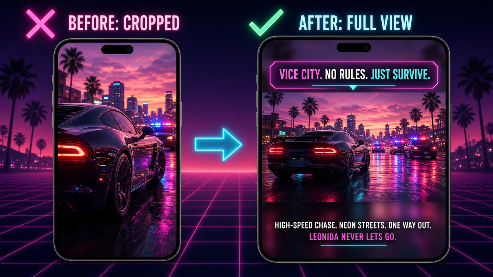

# Full-view vertical layout

**Rule:** the whole 16:9 gameplay frame is always visible. Never crop the action to fill 9:16.



```
+--------------------+  1080 x 1920
|  blurred bg (top)  |  <- hook text, centered at y≈328, wrapped to ~22 chars
|                    |
+--------------------+  y = 656
|  FULL 16:9 GAME    |  1080 x 608, centered
+--------------------+  y = 1264
|  blurred bg (bot)  |  <- word captions (MarginV 330)
|                    |
+--------------------+
```

## The ffmpeg filter

```bash
ffmpeg -i source.mp4 -filter_complex "
  [0:v]split=2[bg][fg];
  [bg]scale=1080:1920:force_original_aspect_ratio=increase,crop=1080:1920,boxblur=20:2,eq=brightness=-0.08[bgb];
  [fg]scale=1080:-2[fgs];
  [bgb][fgs]overlay=(W-w)/2:(H-h)/2,fps=30[v]" \
  -map "[v]" -map 0:a -c:v libx264 -crf 20 -pix_fmt yuv420p \
  -af loudnorm=I=-14:TP=-1.5:LRA=11 -c:a aac -b:a 160k out.mp4
```

Packaged as [`scripts/blur_layout.sh`](../scripts/blur_layout.sh):

```bash
scripts/blur_layout.sh <input> <output.mp4> [start] [duration] ["HOOK"] [captions.srt]
scripts/blur_layout.sh raw/lux.mp4 out/clip.mp4 7.75 89.5 "One duffel bag started this GTA 6 chase" out/clip.srt
```

Env knobs: `HOOK_SIZE` (72), `HOOK_WRAP` (22), `HOOK_Y` (328), `FONT`.

The bundled gtavi cutter also has it: `scripts/gtavi.sh cut jobs/<id> --pick 1 --layout blur --hook "..."` (default layout is `blur`).

## Why

- Shorts/Reels/TikTok viewers want to *see the play*. A center crop of 16:9 throws away ~68% of the frame, often the car, the cops or the HUD.
- Reference: https://youtube.com/shorts/BUwxAT5xoLc
- The 2026-11-20 bag-chase posts were cut with the older `fill` (crop) layout. Full view is the default from that job on.

## Specs every master clip must hit (all 6 accounts)
1080x1920, 30 fps, H.264 + AAC, -14 LUFS, **60-90 s**, captions inside the safe area, creator credited. `check.py` must PASS.
