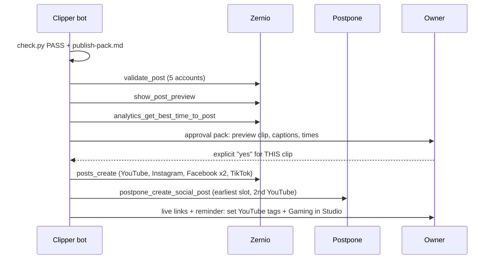

# Posting workflow (human approval required)

1. **Preview first.** The owner watches the master clip before anything is posted.
2. **One explicit yes per clip.** No yes, no post. A yes for one clip never covers the next.
3. **Zernio** (5 accounts): `accounts_list` (re-check every session) → `validate_post` → `show_post_preview` → `posts_create` after yes. Per-platform caption for each account.
4. **Postpone** (YouTube #2): there is no publish-now, so schedule the earliest recommended slot with `scripts/helpers/postpone.sh call postpone_create_social_post '{...}'`.
5. **After posting:** collect live links, post them back, set YouTube tags + Gaming category in Studio, log in `log.md`, feed results into `gtavi-learning-loop` after 24-72 h.

Account IDs are private. Put yours in your agent's memory, never in the repo.
